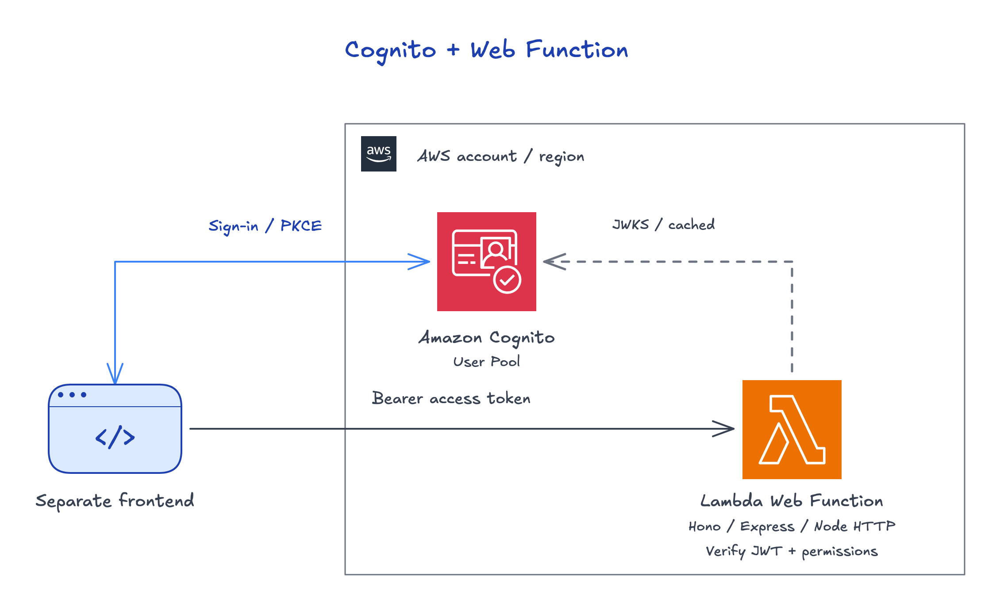

# Lambda Web Function Construct

AWS CDK constructs for deploying Node.js Lambda Web Functions with a private code bucket, immutable revision, and HTTPS endpoint — plus framework wrappers for [Next.js, Astro, Nuxt, and TanStack Start](#framework-web-function-constructs) and optional [Cognito authentication](#optional-cognito-authentication).

Runnable servers, fullstack apps, and benchmarks live under [`examples/`](examples/README.md).

## Install

```sh
npm install lambda-web-function-construct aws-cdk-lib constructs
```

With Bun: `bun add lambda-web-function-construct aws-cdk-lib constructs`.

## Usage

```ts
import { App, Stack } from "aws-cdk-lib";
import {
  WebFunction,
  WebFunctionAuthType,
  WebFunctionEndpointType,
} from "lambda-web-function-construct";

const app = new App();
const stack = new Stack(app, "WebFunctionStack");

new WebFunction(stack, "WebFunction", {
  entry: "src/http.ts",
  functionName: "my-web-function",
  authType: WebFunctionAuthType.APPLICATION_MANAGED,
  endpointType: WebFunctionEndpointType.HOME_REGION,
  endpointName: "prod",
});

app.synth();
```

The entry point is bundled with Bun for Node.js and deployed as a Node.js 24 revision. The construct creates the private S3 code bucket, grants the Lambda service read access to the versioned ZIP, grants the revision execution role scoped CloudWatch Logs permissions, and routes the endpoint to the generated revision.

`WebFunctionAuthType` and `WebFunctionEndpointType` are typed classes with named constants, not TypeScript enums — editor autocompletion and compile-time checking while remaining JSII-compatible. Zod validates values during construct creation; plain strings are not accepted.

Prerequisites: Node.js 24 or later, AWS CDK v2, and Bun on the machine running CDK synthesis (the `entry` bundling). Prebuilt framework artifacts are not bundled at synthesis.

## Optional Cognito authentication

Pass the optional `cognito` parameter for a separate browser frontend with signed-in users:

```ts
const api = new WebFunction(stack, "AuthenticatedApi", {
  entry: "src/http.ts", // Must verify Cognito access tokens on protected routes.
  functionName: "authenticated-api",
  authType: WebFunctionAuthType.APPLICATION_MANAGED,
  endpointType: WebFunctionEndpointType.HOME_REGION,
  cognito: {
    domainPrefix: "my-unique-app-login",
    callbackUrls: ["https://app.example.com/auth/callback"],
    logoutUrls: ["https://app.example.com/"], // defaults to callbackUrls
  },
});
// Available only when cognito is configured:
// api.userPool, api.userPoolClient, api.userPoolDomain
```

What it creates: a retained Cognito User Pool, a public app client **without a secret**, and a managed-login v2 domain. Authorization code flow for frontend PKCE login, token revocation, and refresh-token rotation. The pool disables public sign-up, requires authenticator-app TOTP MFA, and uses the Essentials plan. Access/ID tokens last 10 minutes; refresh tokens 7 days. The construct injects `COGNITO_USER_POOL_ID` and `COGNITO_CLIENT_ID` into the revision and outputs those IDs, the login domain, and the OIDC issuer; those environment-variable names are reserved while `cognito` is configured. Web redirect URLs must use HTTPS except for HTTP loopback development. User pools are retained on stack deletion; review them before deleting user data.

**Provisioning Cognito does not protect application routes.** Your application must verify the `Authorization: Bearer <access_token>` and enforce permissions. Cognito requires `APPLICATION_MANAGED`, not `IAM_AUTH`.



See **[Cognito-protected backend examples](examples/cognito/README.md)** for runnable Hono, Express, and Node HTTP implementations, deployment instructions, exact-origin CORS, PKCE frontend integration, and offline authentication tests. Also: [architecture diagram](examples/cognito/diagrams/cognito-architecture.excalidraw) · [step-by-step OIDC flow](examples/cognito/OIDC_FLOW.md).

## Framework Web Function constructs

Import from the package root (npm ships compiled JavaScript and declarations under `lib/`; the TypeScript source lives in this repository):

| Framework | Construct | Static directory inside the artifact | CloudFront path | Example |
| --- | --- | --- | --- | --- |
| Next.js standalone | [`NextJsWebFunction`](src/nextjs-web-function.ts) | `.next/static/` | `/_next/static/*` | [Next.js](examples/fullstack/nextjs/README.md) |
| Astro SSR (`@astrojs/node`) | [`AstroWebFunction`](src/astro-web-function.ts) | `dist/client/_astro/` | `/_astro/*` | [Astro](examples/fullstack/astro/README.md) |
| Nuxt (Nitro `node-server`) | [`NuxtWebFunction`](src/nuxt-web-function.ts) | `.output/public/_nuxt/` | `/_nuxt/*` | [Nuxt](examples/fullstack/nuxt/README.md) |
| TanStack Start | [`TanStackWebFunction`](src/tanstack-web-function.ts) | `dist/client/assets/` | `/assets/*` | [TanStack Start](examples/fullstack/tanstack-start/README.md) |

Stage your framework's production output first — including runtime dependencies and a root `index.js` launcher that listens on `AWS_LAMBDA_HTTP_ENDPOINT` — and set `artifactDirectory` to the staged directory, not the framework project root. CDK synthesis never runs the framework build; the linked examples include launchers and `build:artifact` scripts.

```ts
const site = new NextJsWebFunction(this, "Site", {
  artifactDirectory: "./artifacts/nextjs",
  functionName: "my-nextjs-site",
  permissions: [
    // Each entry becomes one Allow statement on the revision execution role.
    { actions: "dynamodb:GetItem", resources: [table.tableArn] },
    { actions: ["s3:GetObject", "s3:PutObject"], resources: [bucket.bucketArn] },
  ],
});
// Standard CDK grant APIs work too:
// table.grantReadWriteData(site.webFunction.grantPrincipal)
```

Each construct fronts the Web Function with CloudFront: content-hashed assets come from a private S3 bucket, and other requests go to an IAM-protected home-region Web Function. The constructs do not accept `authType`, `endpointType`, or `cognito` — the delivery hard-requires IamAuth + HomeRegion; use `WebFunction` directly for other combinations. `endpointName` defaults to `"prod"`, `NODE_ENV` to `"production"`, and the asset bucket's removal policy to `RemovalPolicy.RETAIN`.

## Development

Install [mise](https://mise.jdx.dev/getting-started.html), then use the pinned Node.js 24.22.1 and Bun 1.4.4 toolchain:

```sh
mise trust && mise install
mise exec -- bun install --frozen-lockfile
mise exec -- bun install --cwd examples --frozen-lockfile
mise exec -- bun run build            # JSII assembly for Construct Hub
mise exec -- bash examples/fullstack/shared/build-native-artifacts.sh
mise exec -- bun test
mise exec -- bun run test:types && mise exec -- bun run test:types:cognito
```

The full suite uses host-native Astro, Next.js, Nuxt, and TanStack Start artifacts built from their lockfiles. The `oha` smoke test is skipped if `oha` is not on `PATH`. CDK/JSII versions come from `package.json` and `bun.lock`, not mise.

## Publishing

[`.github/workflows/publish.yml`](.github/workflows/publish.yml) runs on pushes to `main`. It installs dependencies, builds the JSII assembly, runs the tests, and publishes only when the version in `package.json` is not already on npm. To release, bump `version` in `package.json`, update `bun.lock` with `bun install`, and push to `main`.

The workflow uses [npm trusted publishing](https://docs.npmjs.com/trusted-publishers) with GitHub OIDC (no token secret) and includes provenance. One-time setup in the [npm package settings](https://www.npmjs.com/package/lambda-web-function-construct/access): add a **GitHub Actions trusted publisher** — user `jolo-dev`, repository `lambda-web-function-construct`, workflow filename `publish.yml`, no environment, and direct `npm publish` allowed if shown.

## License

MIT — see [LICENSE](LICENSE).
