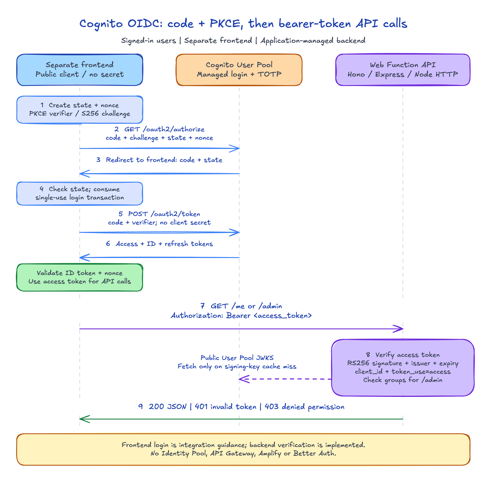

# Cognito OIDC flow for a separate frontend

These examples use **OpenID Connect authorization code flow with PKCE S256** for signed-in browser users, followed by **OAuth access-token authentication** to a separate Web Function backend.



[Editable Excalidraw source](diagrams/oidc-pkce-flow.excalidraw) · [Deployment and setup](README.md)

## What is implemented here

- [`stack.ts`](stack.ts) enables the construct's optional Cognito resources: a User Pool, public app client, managed-login domain, and branding. It supplies the configured frontend origin to the backend.
- [`shared/auth.ts`](shared/auth.ts) verifies Cognito **access tokens** using a reusable `aws-jwt-verify` verifier.
- [Hono](hono/app.ts), [Express](express/app.ts), and [Node HTTP](node-http/app.ts) expose the same authenticated API contract.
- **Frontend login, callback processing, token storage, and renewal are integration responsibilities, not a frontend application shipped in this repository.** The diagram describes how that separate frontend connects to the implemented backends.

## Participants and configuration

| Participant | Responsibility |
|---|---|
| Separate browser frontend | Initiates login, processes its own callback, obtains tokens, and sends the access token to the API. |
| Cognito User Pool | Authenticates the user, issues tokens, and publishes the public signing keys. |
| Web Function backend | Verifies the access token and enforces route-specific permissions. It does not handle the browser's OAuth callback. |

Use the `CognitoClientId`, `CognitoLoginDomain`, and `CognitoIssuer` stack outputs to configure the frontend. Its callback URL must exactly match a registered `callbackUrls` entry; it points to the **frontend**, not the Web Function. The public app client has **no secret**.

Cognito has two distinct URL roles:

- **Managed-login origin:** `<CognitoLoginDomain>` hosts `/oauth2/authorize`, `/oauth2/token`, and `/logout`.
- **OIDC issuer:** `<CognitoIssuer>` is `https://cognito-idp.<region>.<AWS URL suffix>/<userPoolId>`. Discovery is at `/.well-known/openid-configuration`; the public signing keys are at `/.well-known/jwks.json`.

Do not use the managed-login origin as the JWT issuer.

## Numbered flow

### 1. Prepare the browser login transaction

The frontend generates cryptographically random, single-use `state`, `nonce`, and a PKCE `code_verifier`. It derives:

```text
code_challenge = base64url(SHA256(code_verifier))
```

Bind these values to the initiating browser transaction, with a short expiration. Keep the verifier out of the authorization URL. `state` binds the callback to the transaction, PKCE binds code redemption to the initiating client, and `nonce` binds the returned ID token to the login request.

### 2. Redirect to Cognito managed login

Navigate the browser to `<CognitoLoginDomain>/oauth2/authorize` with:

| Parameter | Value |
|---|---|
| `response_type` | `code` |
| `client_id` | The configured public app client ID |
| `redirect_uri` | Exact registered frontend callback URL |
| `scope` | `openid profile email` |
| `state` | Random transaction state |
| `nonce` | Random OIDC nonce |
| `code_challenge` | SHA-256 challenge from step 1 |
| `code_challenge_method` | `S256` |

Cognito performs sign-in as required. The provisioned pool requires authenticator-app TOTP MFA and disables public self-sign-up; invite the user first, as described in the [example README](README.md#create-a-test-user).

### 3. Cognito redirects back to the frontend

After successful authentication, Cognito redirects the browser to the registered frontend callback with a short-lived authorization `code` and the original `state`. This response is not yet an API access token. OAuth failures return error parameters instead; do not continue token exchange on an error callback.

### 4. Validate the callback transaction

The frontend requires the saved transaction to exist and be unexpired, compares the returned `state`, and rejects mismatches or replays. Validate state for error callbacks as well. Consume the transaction once, keep the verifier only as needed to finish the exchange, and remove callback parameters from the browser URL after processing. Never accept a callback based only on a `code` being present.

### 5. Exchange the code using PKCE

The frontend sends an `application/x-www-form-urlencoded` POST to `<CognitoLoginDomain>/oauth2/token` containing:

```text
grant_type=authorization_code
client_id=<public app client ID>
redirect_uri=<the same frontend callback URL>
code=<authorization code>
code_verifier=<saved verifier>
```

Cognito checks the verifier against the original challenge. There is no client secret in this browser flow. Codes are short-lived and single-use; handle token endpoint failures rather than retrying the same code indefinitely.

### 6. Receive and handle tokens

Cognito returns an access token, an ID token, and a refresh token for this authorization code flow.

| Token | Purpose | Used by these backends? |
|---|---|---|
| **Access token** | Grants API access; carries `client_id`, `token_use=access`, and applicable group/scope claims. | **Yes.** Sent as a bearer credential. |
| **ID token** | OIDC identity information for the frontend. Validate signature, issuer, audience, expiration, and nonce before trusting its claims. | **No.** Rejected by the API verifier. |
| **Refresh token** | Obtains replacement tokens from Cognito without another interactive login when permitted. | **No.** Never send it to `/me` or `/admin`. |

Prefer keeping access tokens in memory. Avoid persistent browser refresh-token storage for high-value applications, protect against XSS, and keep all tokens out of URLs and logs. In this construct, access/ID tokens last 10 minutes and refresh tokens last 7 days; refresh-token rotation is enabled.

### 7. Call the separate API with the access token

```http
GET /me HTTP/1.1
Host: <Web Function endpoint domain>
Authorization: Bearer <access_token>
Origin: https://app.example.com
```

The browser may first send a CORS `OPTIONS` preflight because of the `Authorization` header. [`shared/http.ts`](shared/http.ts) permits the configured exact frontend origin, `GET`, and the allowed request headers without requiring a token on the preflight. A valid preflight returns `204`; denied preflights return `403`. The actual protected request still requires authentication. CORS is not authentication, and these APIs do not use application session cookies.

### 8. Verify the access token, then authorize the route

Each server creates one shared verifier using the injected `COGNITO_USER_POOL_ID` and `COGNITO_CLIENT_ID`, with `tokenUse: "access"`. The verifier checks the signature against Cognito's public keys, the expected issuer and app client, expiration, and token type. It caches signing keys and retrieves the pool's JWKS over public HTTPS on a key cache miss; it does **not** contact Cognito to introspect every API request.

After verification:

- `/me` returns `userId` from the verified `sub` and the verified group list. A caller-supplied user ID is not trusted.
- `/admin` additionally requires `admins` in `cognito:groups`.
- `/healthz` is intentionally public.
- Application-specific tenant and resource-ownership checks must be added when you introduce protected application data; those checks are not demonstrated by a real data store here.

### 9. Return the API result

| Result | Status |
|---|---|
| Valid access token and sufficient route permissions | `200` JSON |
| Missing, malformed, forged, expired, wrong-pool, wrong-client, or ID token | `401` with `WWW-Authenticate: Bearer` |
| Verified user without the required admin group | `403` |

The examples do not expose JWT contents or verification errors in authentication-failure responses. Responses use `Cache-Control: no-store`. Unknown routes return `404`.

## Renewal, logout, and revocation

- **Renewal:** send the refresh token to Cognito's `/oauth2/token` endpoint using the refresh-token grant. Save the replacement refresh token when rotation returns one and serialize concurrent refresh attempts. The backend never needs the refresh token.
- **Logout:** clear the frontend's tokens and, if ending the managed-login browser session, navigate to Cognito's `/logout` with the app client ID and an exact registered `logout_uri`.
- **Revocation:** offline JWT verification does not enforce immediate user-disable, logout, or token-revocation state. An otherwise valid access token may remain accepted until it expires. Add server-side checks if immediate revocation is required.
- **Group changes:** obtain a new access token to observe updated membership. Existing tokens retain their previous claims.

## What is intentionally absent

No Cognito Identity Pool, temporary AWS credentials, SigV4 signing, API Gateway authorizer, Amplify, or Better Auth is used. The endpoint uses `APPLICATION_MANAGED`; the example middleware is what protects its routes. Machine-to-machine client credentials are a different flow and are not implemented in these examples.

## Diagram editing

The [standard `.excalidraw` source](diagrams/oidc-pkce-flow.excalidraw) can be opened in Excalidraw. An equivalent Obsidian Excalidraw drawing is saved in the requested vault. After editing, export a white-background, light-mode PNG at 2x scale to `diagrams/oidc-pkce-flow.png`; this guide embeds that sequence diagram. The root README instead embeds the separate [architecture diagram](diagrams/cognito-architecture.png), with its own [editable source](diagrams/cognito-architecture.excalidraw). Its official [AWS icons](diagrams/icons/README.md) are embedded in the drawing, so the source is self-contained.

The drawing follows the requested [Excalidraw diagram skill](https://github.com/axtonliu/axton-obsidian-visual-skills/blob/main/excalidraw-diagram/SKILL.md): editable elements, Excalifont typography, and distinct frontend, identity-provider, and backend colors.

## References

- [Cognito authorization endpoint](https://docs.aws.amazon.com/cognito/latest/developerguide/authorization-endpoint.html)
- [Cognito token endpoint](https://docs.aws.amazon.com/cognito/latest/developerguide/token-endpoint.html)
- [Cognito JWT verification](https://docs.aws.amazon.com/cognito/latest/developerguide/amazon-cognito-user-pools-using-tokens-verifying-a-jwt.html)
